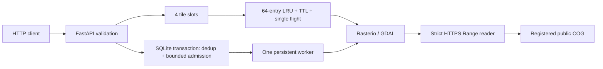

# Architecture and operational limits

## Data and request identity

`geoscene_engine/assets/datasets.json` is packaged with the wheel, along with the local viewer. Set `GEOSCENE_REGISTRY` to an administrator-controlled JSON path to replace it. No write-registration API exists. Cache keys include dataset ID, revision, scale, offset, display range and tile coordinates. Job keys include canonical bbox, dataset ID and revision. Operators must increment revision after upstream changes; no guarantee is made that a provider keeps bytes immutable. Statistics record an array SHA-256 for replay comparison.

## Concurrency and persistence

Tile cache synchronization releases the global lock before computation. Same-key callers wait on an event; exceptions release waiters and are not cached. A bounded semaphore limits simultaneous tile handlers to 4, including waiters. Raster handles are created per operation, never shared between threads. Each range handle retains at most 16 blocks of 1 MiB. GDAL can maintain additional memory, so this is not a total RSS bound.

SQLite WAL plus `BEGIN IMMEDIATE` serializes admission and claim operations. Exactly one service process owns recovery. Startup requeues interrupted running records. Completed and failed jobs persist and duplicate requests return the existing job, including failures. To retry a failed operation after remediation, use a new source revision or an administrator-managed fresh runtime; there is no public destructive retry API. Queue capacity counts queued/running tasks, not completed history. Production service would need retention/archival, distributed ownership/leases, durable external workers, authentication, quotas, monitoring, cancellation and load testing. Those are not claimed here.

## Numerical scope

Tiles use a 256×256 EPSG:3857 destination grid and WarpedVRT bilinear resampling; input nodata becomes transparent PNG alpha. The renderer is a single-band display ramp, not true-color imagery. Statistics read native pixels in a projected envelope. Bounds use pixel-center inclusion, then clamp to dataset extent and reject >1M pixels. Raster masks exclude nodata; cloud cover is not excluded. Float64 scaling is explicit before descriptive statistics.

## Evidence and deployment

`evidence/benchmark.json` is an end-to-end HTTP measurement against the actual public source. It includes every latency, MISS/HIT states, native ROI result, request identity and hash. One tile and ten repeated requests do not estimate system throughput; p95 from n=10 has substantial sampling limitations. No comparison with TiTiler or a competing engine was performed.

The API defaults to local usage. The supplied Dockerfile is for review and reproduction and has not been built on the current host (Docker unavailable). No cloud deployment, load balancer, paid account, multi-worker operation or production security readiness is implied by the name.
