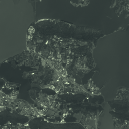

# GeoScene Engine

**把公开 COG 变成可调用的栅格服务。** Python / FastAPI / Rasterio / SQLite；动态瓦片、持久化统计任务、缓存及可复跑的真实数据基准。

[实测展示页](https://clnay5.github.io/geoscene-engine/) · [完整基准记录](evidence/benchmark.json) · [架构与边界](ARCHITECTURE.md)



## 运行与体验

```bash
python -m venv .venv
# Windows: .venv\Scripts\activate
# Linux/macOS: source .venv/bin/activate
python -m pip install -e ".[test]"
python -m pytest -q
python -m uvicorn geoscene_engine.api:app --host 127.0.0.1 --port 8091 --workers 1
```

打开 `http://127.0.0.1:8091/viewer/` 操作真实瓦片和异步统计；`/docs` 为 OpenAPI。另开终端执行 `python scripts/benchmark.py`。在线展示页保存实际执行记录，动态后端在本地启动；未采购云服务器。

可构建 Docker：`docker build -t geoscene-engine .`，然后 `docker run --rm -p 127.0.0.1:8091:8091 -v geoscene-runtime:/app/runtime geoscene-engine`。本机没有 Docker，镜像构建未实测；Python 路径已实际运行。不要开启多个 Uvicorn workers：队列恢复逻辑设计为单进程拥有者。

## 接口

| 接口 | 行为 |
|---|---|
| `GET /datasets` | 服务器注册的数据源与版本、STAC 来源 |
| `GET /tiles/{id}/{z}/{x}/{y}.png` | 256px WebMercator 瓦片、透明 nodata、ETag / 304 / X-Cache |
| `POST /jobs` | `{"dataset":"wuhan-green","bbox":[114.38,30.54,114.40,30.56]}` |
| `GET /jobs/{id}` | queued → running → succeeded / failed，保留结果或错误 |
| `GET /health`, `/metrics` | 当前服务状态、缓存命中与有限资源配置 |

只接受注册 ID，调用者无法传任意 URL。区域统计上限 100 万原生像元，bbox 每边 ≤0.2°；最大 4 个并行瓦片、16 个等待/运行统计任务，超限 HTTP 429。缓存 64 条、TTL 300s；相同瓦片并发合并为一次源计算。规范化请求和注册 revision 的 SHA‑256 是任务 ID，SQLite 事务内完成去重和队列容量检查。

## 真数据实测

数据：2021‑09‑21 武汉 Sentinel‑2 B03 COG，公开源文件，未应用云掩膜。本机一次真实远程瓦片请求 + 10 次串行热缓存请求：

- 首次请求：**5977.46 ms**；缓存状态 MISS。
- 热缓存 p50：**3.63 ms**；p95：**4.27 ms**；10 次均 HIT。
- 区域统计：**44,522 个原生有效像元**，异步任务约 **3430.67 ms**；相同请求返回同一个任务。

这是一次网络与本机环境下的小样本记录，不代表并发吞吐、生产 SLO 或普适加速倍数。首次请求不保证上游 CDN 或操作系统冷缓存。重跑时先检查返回的缓存状态及任务是否已存在；已完成任务不会重新计算。`GEOSCENE_RUNTIME` 可指定新的可写目录，重启服务会清空内存瓦片缓存。原始数值、时间、窗口、数组哈希和作用范围见 JSON。`environment-lock.txt` 是本次完整环境记录，项目最小依赖由 pyproject 声明。

## 质量与解释

测试涵盖并发合并、TTL/LRU、异常重试、SQLite 去重/限流/中断恢复、HTTP 校验与条件缓存，以及实际 GDAL 的 nodata、反射率缩放、描述统计和 PNG 重投影。使用合成夹具验证数值，再以真实 COG 验证服务链路。

区域统计使用 bbox 转换到原生投影后的包络矩形，以像元中心为规则；它不是精确的曲线边界裁剪。输出描述统计不是水域分类、去云结果或地表真实性指标。数据源 revision 为管理员维护；上游文件修订后应同步更新，历史任务保留提交时版本，重放时版本不一致将失败。

## 简历表述

在实际复跑并理解后可据实写：

> 实现 COG 栅格分析服务，提供 WebMercator 动态瓦片与异步区域统计，基于有界 LRU/TTL、同键并发合并与条件缓存降低重复读取；使用 SQLite 事务实现任务去重、队列限流和中断恢复，完成真实 Sentinel‑2 数据链路验证与缓存实测。

AI 辅助开发；这里的个人工程贡献是接口、资源边界、任务状态、复算证据与集成，不宣称发明 GDAL 或动态瓦片。实现参考 [Rasterio virtual warping](https://rasterio.readthedocs.io/en/stable/topics/virtual-warping.html)、[FastAPI](https://fastapi.tiangolo.com/)、[TiTiler](https://developmentseed.org/titiler/) 的公开架构思想，未复制其代码。HTTPS Range 读取器复用同一作者的 [LakeWatch](https://github.com/Clnay5/lakewatch) MIT 实现。

自有代码 MIT。源影像：Copernicus Sentinel data (2021), via Element 84 Earth Search / AWS，数据提供者条款独立适用。
